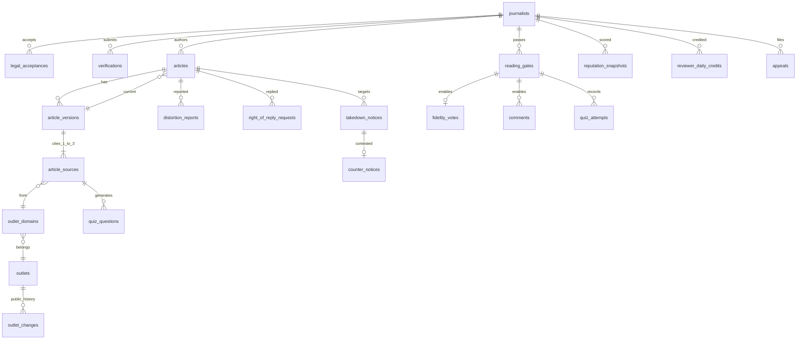

# Modelo de dados

PostgreSQL 16 com JSONB. Princípio: **relacional onde a rule exige garantia, documento onde o dado é documento**.
Toda invariante de produto é validada no banco e coberta por `db/tests/invariants.sql`; a aplicação e a UI apenas refletem.

## Diagrama

## Mapeamento rule → mecanismo no banco

| Rule | Regra | Mecanismo | Teste |
|---|---|---|---|
| `fonte-validada` | 1 a 3 fontes por publicação | `article_sources.position CHECK 1..3` + `UNIQUE(version_id, position)` + constraint trigger `enforce_publication_rules` | publicar com 0 fontes; position 4 |
| `fonte-validada` | Só reportagens | `enforce_publication_rules` exige `classification = 'report'` em todas | publicar com fonte de opinião |
| `fonte-validada` | Só veículos ativos no cadastro | `enforce_publication_rules` exige `outlets.status = 'active'` | fonte de veículo suspenso |
| `fonte-validada` | URL pertence ao domínio declarado | trigger `check_source_url_matches_domain` | URL fora do domínio |
| `fonte-validada` | Registro de integridade, nunca cópia integral | colunas `content_hash`, `meta`, `excerpt varchar(300)`, `archive_url`; não existe coluna de corpo da fonte | — |
| `fonte-validada` | Fonte alterada/indisponível | `hash_status`, `hash_compared_at` | — |
| `fonte-validada` / `avaliacao-fidelidade` | Fonte fora do ar não recebe avaliação nova | triggers `fidelity_votes_require_reachable_source` e `reading_gates_require_reachable_source` | gate em fonte indisponível; voto com todas indisponíveis; voto já válido permanece |
| `cadastro-de-veiculos` | Critérios objetivos de entrada | `outlets_criteria_complete CHECK` (4 chaves obrigatórias no jsonb) | outlet sem política de correções |
| `cadastro-de-veiculos` | Toda mudança tem justificativa pública | `outlet_changes` append-only + constraint trigger `require_outlet_change_entry` | outlet sem histórico; UPDATE em outlet_changes |
| `cadastro-de-veiculos` | Domínio pertence a um só veículo | `outlet_domains.domain citext UNIQUE` | domínio duplicado |
| `perfil-identidade` | Só jornalistas verificados publicam/avaliam | `enforce_publication_rules` e `enforce_reading_gate` exigem `status = 'verified'` | autor não verificado |
| `perfil-identidade` | 1 pessoa = 1 conta | índice único parcial `verifications_one_person_one_account (document_hash) WHERE status='approved'` | mesmo documento aprovado duas vezes |
| `perfil-identidade` | Maioridade declarada | `legal_acceptances_adult_required CHECK` | aceite sem maioridade |
| `perfil-identidade` | Dado bruto descartado | só `document_hash` + `raw_purged_at`; arquivo fora do banco | — |
| `perfil-identidade` | Sem PII além do mínimo | nenhuma coluna; teste varre `information_schema` | colunas de PII |
| `perfil-identidade` | Revisão humana, não auto-aprovação | `verifications_no_self_review`, `verifications_decided_has_reviewer`, `_has_reason` | revisor = jornalista; sem motivo |
| `avaliacao-fidelidade` | Sem like | não existe tabela de reações | — |
| `avaliacao-fidelidade` | Voto só após abrir fonte + quiz | `reading_gates.quiz_passed_at` + trigger `enforce_reading_gate` em votos e comentários | voto/comentário sem quiz |
| `avaliacao-fidelidade` | Quiz tem 2 perguntas | `quiz_attempts_two_questions CHECK` | — |
| `avaliacao-fidelidade` | Um voto por artigo | `fidelity_votes_unique (article_id, journalist_id)` | voto duplicado |
| `avaliacao-fidelidade` | Autor não avalia a si | `enforce_reading_gate` compara `articles.author_id` | autor avaliando próprio artigo |
| `avaliacao-fidelidade` | Comentário com flag obrigatória | `comments.stance NOT NULL` | comentário sem flag |
| `avaliacao-fidelidade` | Rejeição com motivo legível | `*_rejected_has_reason CHECK` | voto rejeitado sem motivo |
| `reputacao-jornalista` | Autor e Avaliador separados | `reputation_snapshots.author` e `.reviewer` jsonb | — |
| `reputacao-jornalista` | Intervalo de confiança ou amostra insuficiente | `reputation_*_shape CHECK` | snapshot sem CI |
| `reputacao-jornalista` | Só votos válidos contam | views `article_fidelity_summary` filtram `filter_status = 'valid'` | voto validado alimenta resumo |
| `reputacao-jornalista` | Retorno decrescente e desconto por rejeição | `reviewer_daily_credits` mantido por `bump_reviewer_credits` | créditos incrementam |
| `reputacao-jornalista` | Tema polêmico não penaliza | view `article_rejection_rate` para normalização | — |
| `integridade-editorial` | Tag obrigatória | `articles.kind NOT NULL` | kind NULL |
| `integridade-editorial` | Tag sai da classificação do texto, com motivo | `article_kind_decisions` append-only (`kind`, `method`, `model`, `reason`); `articles.kind` acompanha a decisão da versão corrente | decisão sem motivo; UPDATE na decisão |
| `integridade-editorial` | Nunca edição silenciosa | `article_versions` append-only; `change_note` obrigatória a partir da v2; `enforce_version_monotonic` | editar in-place; v2 sem nota; voltar versão |
| `integridade-editorial` | Denúncia de distorção sem conflito de interesse | trigger `check_distortion_report_parties` | — |
| `integridade-editorial` | Direito de resposta vinculado ao artigo | `right_of_reply_requests` com FK e `published_at` | — |
| `responsabilidade-legal` | Trilha de auditoria imutável | `audit_log` particionada, append-only, triggers `audit_row_change` em entidades críticas | UPDATE/DELETE em audit_log; eventos do artigo |
| `responsabilidade-legal` | Remoção com rastro formal | `check_article_removal_ref` exige `takedown_notices.protocol`; status `removed`, nunca DELETE | removal_ref inexistente |
| `responsabilidade-legal` | Notificação com boa-fé | `takedown_good_faith_required CHECK` | sem boa-fé |
| `responsabilidade-legal` | Contranotificação por revisor diferente | trigger `check_counter_notice_reviewer` | mesmo revisor |
| `responsabilidade-legal` | Apelação revisada por terceiro | `appeals_no_self_review CHECK` | próprio apelante |
| `responsabilidade-legal` | Vocabulário: plataforma não certifica verdade | nenhuma coluna `verified|truth|approved|checked` em conteúdo; teste varre `information_schema` | vocabulário |
| `responsabilidade-legal` / privacidade | Logs de acesso por 6 meses | `access_logs` particionada; `drop_expired_access_log_partitions()` | — |
| `white-hat` | PII de terceiros cifrada | `notifier_pii`, `requester_pii` como `bytea` via `pgp_sym_encrypt` | — |

## Enums → rótulos em português

| Enum | Valor | Rótulo na UI |
|---|---|---|
| `article_kind` | `report` / `analysis` / `opinion` | Reportagem / Análise / Opinião |
| `fidelity_verdict` | `faithful` / `distorts` | Fiel às fontes / Distorce as fontes |
| `comment_stance` | `agree` / `partially_agree` / `disagree` | Concordo / Concordo parcialmente / Discordo |
| `filter_status` | `pending` / `valid` / `rejected` | Em análise / Válido / Rejeitado |
| `source_classification` | `report` / `opinion` / `unknown` | Reportagem / Opinião / Não classificada |
| `source_hash_status` | `ok` / `changed` / `unavailable` | — / Fonte alterada desde a publicação / Fonte indisponível |
| `journalist_status` | `pending_verification` / `verified` / `suspended` / `banned` / `closed` | Aguardando verificação / Jornalista verificado / Suspenso / Banido / Encerrada |
| `outlet_status` | `active` / `suspended` / `removed` | Ativo / Suspenso / Removido |
| `article_status` | `draft` / `published` / `removed` / `author_deleted` | Rascunho / Publicado / Removido / Removido pelo autor |
| `removal_reason` | `court_order` / `valid_notice` / `terms_violation` / `author` | Ordem judicial / Notificação válida / Violação dos Termos / Decisão do autor |
| `notice_category` | `court_order` / `evident_illicit` / `terms_violation` | Ordem judicial / Ilicitude evidente / Violação dos Termos |
| `verification_method` | `professional_registry` / `outlet_affiliation` / `portfolio` | Registro profissional / Vínculo com veículo / Portfólio |

Atenção ao vocabulário (`responsabilidade-legal.mdc`): o selo de `journalist_status = 'verified'` é exibido como
"jornalista verificado" (identidade), nunca como "conteúdo verificado". Reputação é "avaliação entre pares".

## Onde JSONB é usado e por quê

| Coluna | Conteúdo | Motivo |
|---|---|---|
| `article_versions.body` | Documento do editor (blocos) | Estrutura do editor evolui; não precisa de consulta relacional |
| `article_sources.meta` | `{title, outlet, published_at, author}` | Metadados variam por veículo |
| `outlets.criteria` / `signals` | URLs de evidência; filiações | Lista de critérios pode crescer; CHECK garante as 4 chaves mínimas |
| `verifications.evidence_meta` | Tipo de documento, veículo, links | Varia por método; nunca contém o documento em si |
| `reputation_snapshots.author` / `reviewer` | `{score, ci_low, ci_high, n_valid, insufficient}` | Snapshot imutável por versão de algoritmo |
| `audit_log.payload` | `{old, new}` da linha | Forma varia por tabela |
| `quiz_questions.options` | Alternativas | Lista simples |

## Fluxos e transações esperadas

**Publicar**: em uma transação, inserir `article_versions` → inserir 1–3 `article_sources` → `UPDATE articles SET status='published', current_version_id=...`. A checagem roda no `COMMIT` (constraint trigger deferred).

**Corrigir**: inserir nova `article_versions` (com `change_note`) e suas fontes → `UPDATE articles SET current_version_id`. A versão anterior permanece intacta e pública.

**Avaliar**: inserir `reading_gates` ao abrir uma fonte ainda alcançável → registrar `quiz_attempts` → se 2 acertos, `UPDATE reading_gates SET quiz_passed_at` → inserir `fidelity_votes` ou `comments` → job de filtro faz `UPDATE ... SET filter_status, filter_reason, filtered_at`. Se toda fonte da versão corrente está `unavailable`, o `INSERT` do voto é rejeitado; o `UPDATE` do filtro de um voto já enviado continua.

**Remover**: inserir `takedown_notices` → decidir (`status='removed'`, `decision`) → `UPDATE articles SET status='removed', removal_reason, removal_ref=protocol`. A aplicação renderiza o placeholder; o banco preserva tudo.

**Criar conta**: numa transação, `set_config` de `app.session_hash` e `app.ip_hash`, inserir `journalists` (status `pending_verification`, senha já em Argon2id), três linhas em `legal_acceptances` (termos, privacidade e conteúdo, versão vigente, maioridade) e o evento `journalist.create` em `audit_log` sem senha e sem e-mail. O cookie leva só o token; o dado fica em `sessions`.

## O que ainda não está no schema

- Publicidade (`ad_slots`, `ad_article_exclusions`) — próxima iteração.
- Jobs de reputação, filtro de qualidade, geração de quiz e recheque de hash — aplicação.
- Ampliação contínua do cadastro de veículos (lote inicial em `db/seeds/cadastro_veiculos.sql` e `docs/cadastro-de-veiculos.md`).
